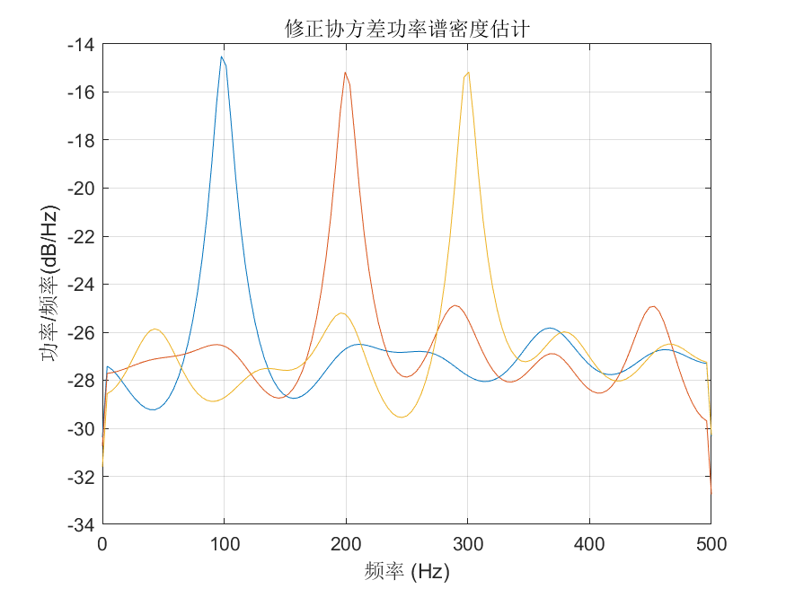

# MATLAB | Spectral Analysis Algorithm | Covariance Power Spectrum Density Estimation | Included data and plotting code | Directly Useable

1. Basic Definition of Modified Covariance Method (MCM) for Spectral Estimation
The Modified Covariance Method (MCM) is a spectral estimation method based on covariance analysis, which can perform spectral analysis on time-domain signals to obtain the energy distribution at different frequencies of the signal. MCM has been widely applied in fields such as signal processing, communication, acoustics, etc. Compared to traditional covariance spectral estimation methods, it offers better frequency resolution and estimation accuracy. The steps of MCM are as follows:
Given a time-domain signal x(n) with a length of N.
Perform preprocessing operations such as windowing and FFT on the signal to obtain its frequency domain representation.
Based on the frequency domain representation, obtain the signal's covariance matrix, that is: C(ω) = E[X(ω) * X^H(ω)], where X(ω) is the frequency domain representation of the signal at frequency ω, X^H(ω) is the conjugate transpose of X(ω), and E[.] denotes expectation.
Correct the covariance matrix by subtracting a correction factor δI from it, resulting in the corrected covariance matrix: Cm(ω) = C(ω) - δI, where δ is the correction factor and I is the identity matrix.
Calculate the power spectral density estimation value of the signal using the corrected covariance matrix: P(ω) = trace[Cm(ω)]/M, where trace[.] represents the trace operation of a matrix, and M is the length of the signal. The advantages of MCM include high-precision spectral analysis of signals, better frequency resolution and estimation accuracy, and good estimation effects for nonlinear components present in signals such as harmonics. However, this method requires matrix operations, leading to increased computational complexity, and may not perform as well in estimating higher-order harmonics and other higher-order components of signals compared to other methods.
2. Definition and Outline Effects
The outline effects are as follows:
\n        \n          \n          \n          \n          \n            To view this video please enable JavaScript, and consider upgrading to a\n            web browser that\n            supports HTML5 video\n  

## Images

<!-- PAYMENT_BLOCK -->

## Get this dataset

- Payment link (Stripe): [Buy now](https://buy.stripe.com/3cs8yP7sY87d0vu9AB)
- Payment QR code: 

<!-- /PAYMENT_BLOCK -->
